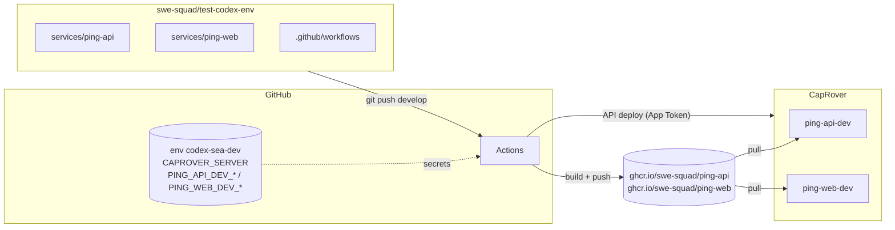
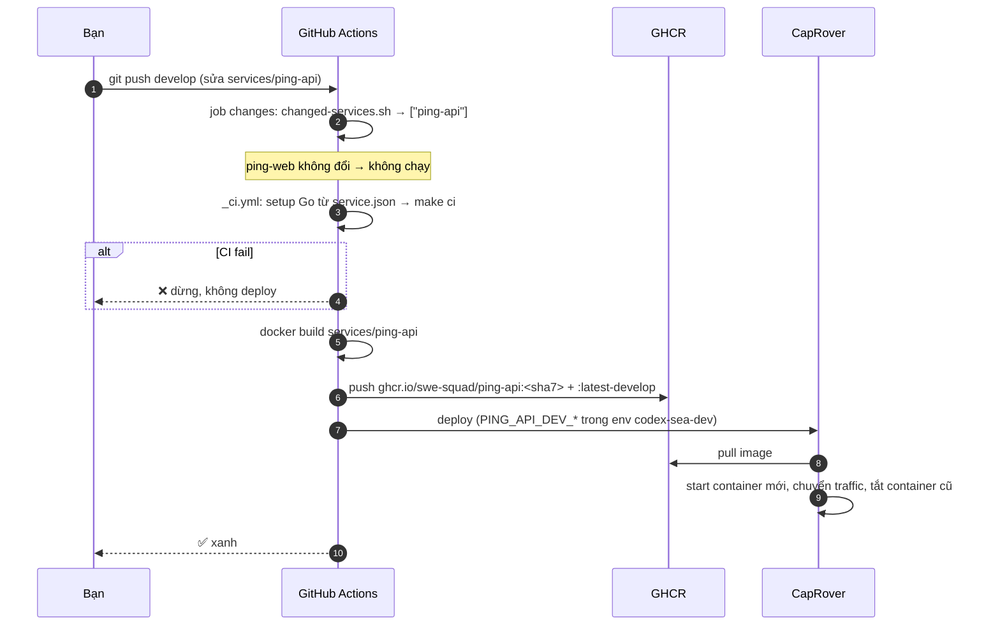
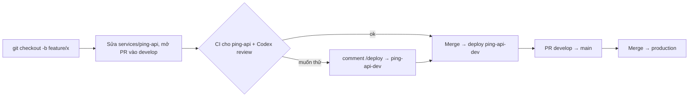

# Flow: từ tạo service đến chạy trên CapRover (monorepo)

`test-codex-env` (`swe-squad/test-codex-env`) là **monorepo**:

- Mỗi service nằm trong một thư mục `services/<tên>/`.
- Tất cả service dùng chung bộ workflow ở `.github/workflows/`.
- Mỗi lần push hay mở PR, **chỉ những service có thay đổi** mới chạy CI và deploy.

Guide này viết cho server CapRover hiện tại, lấy theo bản backup `captain.json`. Ví dụ là 2 service đang có trong repo:

| Service | Template | Endpoint kiểm tra | App CapRover (dev) | Port |
|---|---|---|---|---|
| `ping-api` | go-gin | `GET /api/v1/ping` | `ping-api-dev` | 8080 |
| `ping-web` | react-vite | `GET /ping` | `ping-web-dev` | 80 |

Mặc định mỗi service **chỉ có app dev**. Production là tuỳ chọn, xem [Thêm Production](#thêm-production-cho-một-service).

## Server CapRover hiện tại

| Mục | Giá trị |
|---|---|
| Dashboard / `CAPROVER_SERVER` | `https://captain.cr.ngochoanielts.com` |
| URL mặc định của app | `https://<app>.cr.ngochoanielts.com` |
| Registry GHCR | `ghcr.io` (registry mặc định), hiện dùng PAT của `ielts-ngoc-hoan` |
| Gọi nội bộ giữa các app | `srv-captain--<app>:<port>`, ví dụ `srv-captain--ielts-db:5432` |

> ⚠️ **Bảo mật:**
>
> - `captain.json` chứa secret thật và đã được thêm vào `.gitignore`. **Không commit file này.**
> - `db-test` và `redis-test` đang mở port `54322` và `63791` ra Internet.

---

## Cách mọi thứ nối với nhau



- **CapRover không tự đọc GitHub.** GitHub Actions là bên gọi API của CapRover, dùng secrets lưu trong GitHub environment:
  - `CAPROVER_SERVER`: gọi vào server nào (dùng chung cho mọi service).
  - `<SVC>_<DEV|PROD>_APP_NAME`: app nào, ví dụ `PING_API_DEV_APP_NAME`.
  - `<SVC>_<DEV|PROD>_CAPROVER_TOKEN`: token chứng minh có quyền deploy, ví dụ `PING_API_DEV_CAPROVER_TOKEN`.
- **Environment dùng chung:** mọi service dùng chung `codex-sea-dev` (develop) và `codex-sea-prod` (production). `<SVC>` là tên service viết hoa, `-` đổi thành `_`, nên mỗi service vẫn trỏ được tới app riêng của nó.
- **CapRover pull image từ GHCR** bằng PAT đã cấu hình trong registry.

---

## Checklist làm 1 lần

### A. Registry GHCR (một lần cho cả server)

Registry hiện tại dùng PAT của `ielts-ngoc-hoan`, nhiều khả năng không đọc được package của `swe-squad`. Tài khoản `minhvip08` là admin của cả 2 org, nên dùng PAT của tài khoản này:

- [ ] **Tạo PAT:** mở https://github.com/settings/tokens/new?scopes=read:packages&description=caprover-ghcr
  - Loại classic, chỉ tick scope `read:packages`.
  - Chọn expiration dài và đặt nhắc lịch thay token. Token hết hạn thì **mọi** app sẽ không pull được image.
- [ ] **Kiểm tra token** (chạy trong terminal của bạn):

  ```bash
  read -s PAT
  GH_TOKEN=$PAT gh api "orgs/ielts-ngoc-hoan/packages?package_type=container" -q '.[].name'   # thấy ielts-ngoc-hoan-be/fe
  GH_TOKEN=$PAT gh api "orgs/swe-squad/packages?package_type=container" -q '.[].name'         # rỗng là được, miễn không 403
  ```

- [ ] **Cập nhật registry:** vào CapRover → **Cluster → Docker Registry Configuration**, sửa registry `ghcr.io`:
  - Username: `minhvip08`
  - Password: PAT vừa tạo

  Giữ registry này là default, và chỉ để **một** registry cho `ghcr.io`.
- [ ] **Kiểm tra app cũ:** redeploy thử app `ielts-api`, để chắc image cũ vẫn pull được.

### B. CapRover: tạo app dev cho mỗi service

Mở `https://captain.cr.ngochoanielts.com` → **Apps** → tạo `ping-api-dev` và `ping-web-dev`. Với **mỗi app**:

- [ ] **HTTP Settings:** bấm **Enable HTTPS**, rồi bật **Force HTTPS**.
- [ ] **App Configs:** đặt **Container HTTP Port** bằng giá trị `port` trong `service.json` của service đó:
  - `ping-api-dev` → `8080`
  - `ping-web-dev` → `80`

  Bấm **Save & Update**. Env vars runtime (DB, key...) cũng thêm ở đây.
- [ ] **App Configs → Environment Variables:** URL gọi nội bộ giữa các app (HTTP, mạng nội bộ của CapRover):
  - `ping-web-dev`: `PING_API_URL=http://srv-captain--ping-api-dev:8080`
  - `ping-api-dev`: `PING_2_URL=http://srv-captain--ping-2-dev:8000`

  Trình duyệt chỉ gọi `https://ping-web-dev.../api/...`; nginx trong ping-web chuyển tiếp nội bộ sang ping-api,
  nên không cần CORS và ping-api có thể bật **Do not expose as web app**.
- [ ] **Deployment:** bật **App Token** rồi copy token. Không lưu token vào file.

### C. GitHub: tạo environment và secrets

Chạy trong terminal của bạn, từ root của repo. Gõ token trực tiếp, đừng dán vào chat:

```bash
cd /home/simi/workspace/github/agentic/test-codex-env

CAPROVER_SERVER=https://captain.cr.ngochoanielts.com \
APP_NAME_DEVELOP=ping-api-dev CAPROVER_TOKEN_DEVELOP=<token ping-api-dev> \
  scripts/setup-service.sh ping-api dev

CAPROVER_SERVER=https://captain.cr.ngochoanielts.com \
APP_NAME_DEVELOP=ping-web-dev CAPROVER_TOKEN_DEVELOP=<token ping-web-dev> \
  scripts/setup-service.sh ping-web dev
```

- [ ] Script tạo environment `codex-sea-dev` trên repo `swe-squad/test-codex-env` (nếu chưa có), và điền secrets của từng service vào đó.

**Muốn làm tay trên web thay vì chạy script:** vào repo → **Settings → Environments → New environment**.

1. Đặt tên `codex-sea-dev`. Thêm secrets:

   | Secret | Giá trị |
   |---|---|
   | `CAPROVER_SERVER` | `https://captain.cr.ngochoanielts.com` |
   | `PING_API_DEV_APP_NAME` | `ping-api-dev` |
   | `PING_API_DEV_CAPROVER_TOKEN` | App Token của `ping-api-dev` |
   | `PING_WEB_DEV_APP_NAME` | `ping-web-dev` |
   | `PING_WEB_DEV_CAPROVER_TOKEN` | App Token của `ping-web-dev` |

2. **Không** đặt `VITE_API_BASE_URL` trong tab **Variables**: để trống thì ping-web gọi `/api/` cùng origin.
   Đặt URL của ping-api vào đây sẽ khiến trình duyệt gọi thẳng sang ping-api và bị chặn CORS ("Failed to fetch").

### D. Push code (lần đầu)

Repo hiện chưa có commit nào. Lần push đầu sẽ deploy **mọi** service:

```bash
cd /home/simi/workspace/github/agentic/test-codex-env
git add -A && git commit -m "feat: monorepo with ping-api and ping-web"
git push -u origin main
git checkout -b develop && git push -u origin develop
```

- [ ] **Push `main`:** deploy mọi service lên production. Service nào chưa có secrets `_PROD_` sẽ đỏ ở bước *Check CapRover secrets*.
- [ ] **Push `develop`:** deploy `ping-api` → `ping-api-dev` và `ping-web` → `ping-web-dev`.

### E. Kiểm tra

- [ ] **GitHub → Actions → Deploy** (lần chạy của `develop`): job `changes` liệt kê `["ping-api","ping-web"]`. Hai job `ping-api` và `ping-web` đều xanh.
- [ ] **CapRover → `ping-api-dev` → Deployment:** đang chạy `ghcr.io/swe-squad/ping-api:<sha7>`. Kiểm tra tương tự với `ping-web-dev`.
- [ ] **Terminal:**

  ```bash
  curl https://ping-api-dev.cr.ngochoanielts.com/api/v1/ping   # {"message":"pong","service":"ping-api"}
  curl https://ping-web-dev.cr.ngochoanielts.com/ping          # {"message":"pong","service":"ping-web"}
  ```

### F. AI review (một lần cho cả repo)

- [ ] **Codex settings → Code review:** bật `swe-squad/test-codex-env`.
  - Codex đọc `AGENTS.md` ở root (luật chung) và `services/<x>/AGENTS.md` (luật riêng của từng stack).

---

## Một lần deploy diễn ra thế nào



| Trigger | Service nào | Deploy lên | Image tags |
|---|---|---|---|
| Push / merge vào `develop` | Service có thay đổi | `codex-sea-dev` | `<sha7>`, `latest-develop` |
| Push / merge vào `main` | Service có thay đổi | `codex-sea-prod` | `<sha7>`, `latest-main` |
| Comment `/deploy` trên PR | Service có thay đổi trong PR | `codex-sea-dev` | `<sha7>`, `pr-<số>` |
| Comment `/deploy ping-web` | Chỉ service được ghi tên | `codex-sea-dev` | `<sha7>`, `pr-<số>` |
| Actions → *Deploy* → Run workflow | Danh sách nhập vào (để trống = tất cả) | `main` → production, nhánh khác → develop | `<sha7>`, `latest-<branch>` |

Khi nào một service được tính là "có thay đổi": có file thay đổi bên trong `services/<svc>/`. Thay đổi file ở root, như README hay docs, không deploy service nào.

## Thêm service mới

```
/new-service python-fastapi report-api       # Claude Code (hoặc $new-service ... trong Codex)
```

Hoặc chạy tay:

1. `scripts/new-service.sh python-fastapi report-api`: tạo `services/report-api/`.
2. CapRover: tạo app `report-api-dev` (port `8000`), bật HTTPS và App Token.
3. `CAPROVER_SERVER=... APP_NAME_DEVELOP=report-api-dev CAPROVER_TOKEN_DEVELOP=... scripts/setup-service.sh report-api dev`
4. Commit, mở PR vào `develop`, rồi merge. Lần merge này deploy `report-api`.

Không cần sửa workflow nào. Workflow tự nhận service mới nhờ file `service.json`.

## Thêm Production cho một service

1. **CapRover:** tạo app `ping-api` (không có `-dev`), cấu hình giống app dev. Thường sẽ gắn domain thật.
2. **Terminal:** chạy lại script với giá trị production:

   ```bash
   CAPROVER_SERVER=https://captain.cr.ngochoanielts.com \
   APP_NAME_DEVELOP=ping-api-dev    CAPROVER_TOKEN_DEVELOP=<token dev> \
   APP_NAME_PRODUCTION=ping-api     CAPROVER_TOKEN_PRODUCTION=<token prod> \
     scripts/setup-service.sh ping-api both
   ```

   Script ghi `PING_API_PROD_*` vào environment `codex-sea-prod` (tạo nếu chưa có).
3. **GitHub:** vào Actions → *Deploy* → **Run workflow** trên `main`, ô services nhập `ping-api`, để deploy lần đầu. Từ đó trở đi, mỗi lần merge vào `main` có sửa `ping-api` là tự deploy production.

Mọi service có thay đổi trên `main` đều deploy production, nên chuẩn bị app prod và secrets `_PROD_` trước khi merge service đó vào `main`.

## Làm việc hằng ngày



- **PR:** chỉ service có thay đổi mới chạy CI. Trong tab Checks, job hiện tên theo service, ví dụ `ci / ping-api`.
- **Comment `/deploy`:**
  - Bot thả reaction 🚀, rồi comment ✅/❌ kèm danh sách service đã deploy.
  - App dev giữ bản của PR cho tới lần merge vào `develop` tiếp theo.
- **Rollback:**
  - Vào Actions → *Deploy* → Run workflow trên commit cũ, ô services nhập tên service.
  - Hoặc vào CapRover → app → **Deployment**, chọn version cũ rồi deploy lại.

## Lỗi thường gặp

| Triệu chứng | Nguyên nhân hay gặp | Cách sửa |
|---|---|---|
| Job `changes` ra `[]` nên không deploy gì | Push không đụng tới file nào trong `services/` | Bình thường. Muốn deploy thì vào Actions → Run workflow |
| Fail ở *Deploy image to CapRover* (auth/token) | Environment `codex-sea-dev` thiếu hoặc sai `<SVC>_DEV_*` (bước *Check CapRover secrets* in ra tên secret thiếu) | Kiểm tra **Settings → Environments**, rồi **Re-run** |
| CapRover báo `unauthorized`/`denied` khi pull | PAT của registry không đọc được `ghcr.io/swe-squad/*` | Làm lại mục A |
| Deploy xanh nhưng mở web báo **502** | Container HTTP Port khác `port` trong `service.json` | Sửa trong App Configs |
| Lỗi SSL hoặc không vào được | Chưa bấm Enable HTTPS cho app | Vào HTTP Settings của app |
| `ping-web` báo "Failed to fetch" | `VITE_API_BASE_URL` trong `codex-sea-dev` đang có giá trị, trình duyệt gọi thẳng ping-api và bị chặn CORS | Xoá biến rồi deploy lại `ping-web` (biến nhúng lúc build) |
| `/api/v1/ping` trả 502 | `PING_API_URL` (ping-web) hoặc `PING_2_URL` (ping-api) thiếu hoặc sai hostname | Đặt `http://srv-captain--<app>:<port>` trong App Configs, Save & Update |
| Fail ở job `ci` | `make ci` của service fail | Chạy `make ci` trong `services/<svc>` ở local để xem lỗi |

---

Tên các mục menu CapRover trong tài liệu này có thể hơi khác tuỳ phiên bản.
